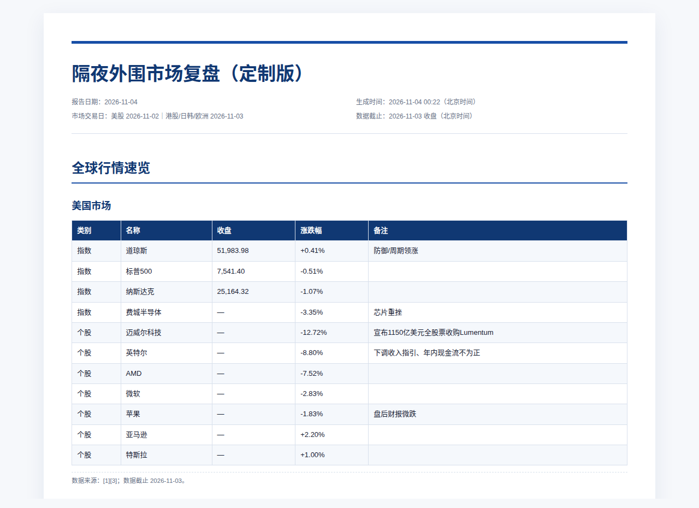
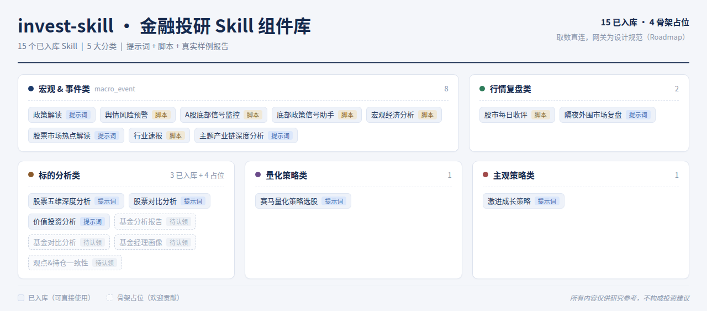
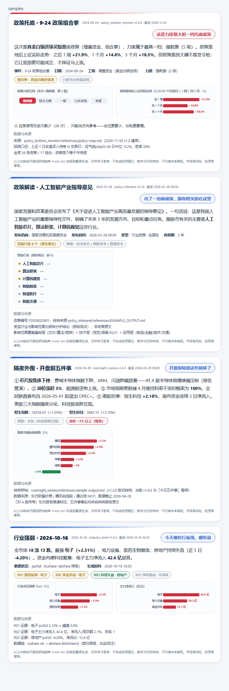

# invest-skill

> **15 个开箱即用的金融投研 Skill**——把选股、诊股、盘前/午盘/盘后综合分析、策略等高频场景，沉淀为可复用、可组合的提示词与脚本组件。给 Agent 一份 `SKILL.md`，它就能按专业流程做投研分析。

[](LICENSE)
[](https://www.python.org/)
[](ASSETS.md)
[](https://gitee.com/warwickInv/invest-skill)

> ⚠️ 仅供学习研究与技术参考，**不构成投资建议**。完整免责见[文末](#免责声明与许可证)。

---

## 30 秒了解这个项目

一句话：**你描述需求，Agent 按专业投研流程产出可溯源的分析报告。**

| 你想做的事 | 直接说一句话 | 用到的能力 |
|---|---|---|
| 判断能不能抄底 | "创业板指现在能抄底吗" | A股底部信号监控 |
| 盘前梳理今日机会 | "做份今天的盘前分析" | 盘前综合分析（6 步编排） |
| 盘后复盘一整天 | "做份今天的盘后综合分析" | 盘后综合分析（7 步编排） |
| 读懂一份政策 | "解读一下这份政策文件" | 政策解读 |
| 隔夜外围发生了什么 | "做份隔夜外围复盘" | 隔夜外围市场复盘 |
| 对比两只股票 | "对比茅台和五粮液" | 股票对比分析 |
| 判断估值贵不贵 | "中际旭创现在贵不贵" | 价值投资分析 |
| 把报告讲给小白听 | "把这份报告做成小白卡" | 小白卡输出层 |

**它不是什么**：不是自动交易框架，不提供实时行情、不托管数据、不给出买卖建议。
**适合谁**：想快速搭建投研 Agent 的开发者、需要结构化方法论的分析师、想贡献金融 Skill 的开源参与者。

---

## 15 个 Skill 速览

<details open>
<summary><b>宏观 &amp; 事件类（8）</b></summary>

| Skill | 形态 | 作者 | 说明 |
|---|---|---|---|
| [政策解读](skills/macro_event/policy_interpret/) | llm_prompt | 周周 | 政策文件解读与行业影响分析，输出可溯源结构化结论 |
| [舆情风险预警](skills/macro_event/sentiment_risk_warning/) | script_based | 姜青、Warwick | 舆情+量价特征训练随机森林，预测次日波动率风险并分级 |
| [A股底部信号监控](skills/macro_event/a_share_bottom_monitor/) | script_based | Warwick | 2014–2026 十二年回测的信号地图，抄底位置监控 + 半年度自更新 + 状态/路径/执行三层决策检查表 |
| [底部政策信号助手](skills/macro_event/policy_bottom_monitor/) | script_based | Warwick | 托底政策双轴分级（S/A/B/C/D），与量价信号叠加，含自更新机制 |
| [宏观经济分析](skills/macro_event/macro_analysis/) | script_based | 姜青 | 五维度宏观框架 → A 股行业景气与风格轮动报告 |
| [股票市场热点解读](skills/macro_event/market_hotspot/) | llm_prompt | 周周 | 七大模块覆盖热点识别→产业链映射→资金情绪→风险预警 |
| [行业速报](skills/macro_event/industry_brief/) | script_based | Warwick | 行业动态与事件速报，四级可降级数据源 |
| [主题产业链深度分析](skills/macro_event/concept_chain_analysis/) | llm_prompt | Warwick | 上/中/下游 × 核心/弹性/补涨纵深拆解，可选持仓交叉 |

</details>

<details open>
<summary><b>标的分析类（3 已入库 + 4 占位）</b></summary>

| Skill | 形态 | 作者 | 说明 |
|---|---|---|---|
| [股票五维深度分析](skills/subject_analysis/stock_5d_deep_analysis/) | llm_prompt | Warwick | 基本面/技术面/资金面/消息面/估值五维深度报告 |
| [股票对比分析](skills/subject_analysis/stock_comparative_analysis/) | llm_prompt | 周周 | 2–5 只股票（含 A+H）分析师级对比报告，Markdown + HTML |
| [价值投资分析](skills/subject_analysis/value_investing/) | llm_prompt | 姜青、Warwick | 自上而下五步基本面框架，好公司≠好股票、价值≠价格，可选四层打分卡 |
| 基金分析报告 / 基金对比 / 基金经理画像 / 一致性分析 | — | — | 🔨 骨架占位，[欢迎认领](CONTRIBUTING.md) |

</details>

<details open>
<summary><b>行情复盘类（2）· 量化策略类（1）· 主观策略类（1）</b></summary>

| Skill | 分类 | 形态 | 作者 | 说明 |
|---|---|---|---|---|
| [股市每日收评](skills/market_review/market_daily_review/) | 行情复盘 | script_based | Warwick | 十段式收评，四级数据源降级，全字段带溯源与降级标记 |
| [隔夜外围市场复盘](skills/market_review/overnight_review/) | 行情复盘 | llm_prompt | 周周、姜青、Warwick | Bloomberg「今日五件事」决策层 + 常驻决策时间线，MD/自包含 HTML 双输出 |
| [赛马量化策略选股](skills/quant_strategy/racing_quant_pick/) | 量化策略 | llm_prompt | Warwick | 偏好匹配策略 → 拉取持仓 → 衔接个股分析 |
| [激进成长策略](skills/subjective_strategy/aggressive_growth_strategy/) | 主观策略 | llm_prompt | Warwick | 道·法·术·器完整方法论，成长股挖掘与评级 |

</details>

此外还有两个**横切全库的能力**（不计入上面 15 个 Skill）：

| 能力 | 形态 | 作者 | 说明 |
|---|---|---|---|
| [小白卡可视化输出层](presentation/) | llm_prompt + 脚本 | 刘宇恒 | 把 15 个 Skill 的报告翻译成普通用户一眼看懂的小白卡片（PNG 交付） |
| [盘前/午盘/盘后综合分析](apps/scenarios/session_analysis/) | 编排场景 | Warwick | 按时段配方调度多个 Skill，产出可追溯 MD 报告 + PNG 卡片，随 Skill 更新自动迭代 |

完整资产清单（含版本、数据来源、状态）见 **[`ASSETS.md`](ASSETS.md)**。

---

## 怎么用：把提示词丢给 Agent

每个 Skill 都是一个**自描述的能力包**——核心是 `SKILL.md`：开头告诉 Agent「我是谁、何时用我」，正文告诉它「具体怎么做」。不用装库、不用记命令，把说明书交给 Agent，说人话即可。

### 调用单个 Skill

把下面这段发给 Agent（链接打开即完整说明书），把【】换成你的需求就能用：

> 请严格按这份技能说明帮我**【你的需求】**，遵循其中的强制执行流程和数据纪律：
> `https://gitee.com/warwickInv/invest-skill/raw/main/skills/macro_event/a_share_bottom_monitor/SKILL.md`

随手写几个例子：
- "帮我判断创业板指现在能不能抄底"（上面这条链接直接用）
- "用美林时钟判断现在该配周期还是成长"（换成 `skills/macro_event/macro_analysis/`）
- "对比分析贵州茅台和五粮液"（换成 `skills/subject_analysis/stock_comparative_analysis/`）

> 换 Skill 只需改链接里的目录名，目录名见上方速览表。给整个仓库地址 + 目录路径（`https://gitee.com/warwickInv/invest-skill` 的 `skills/.../`）能让它连 `references/` 一起读，输出最完整；Agent 不能联网就把 SKILL.md 全文贴进对话。

### 做盘前 / 午盘 / 盘后综合分析

这是 `session_analysis` 编排场景——Agent 会自己按声明式配方，在对应时段调度多个 Skill，交付 **MD 报告 + PNG 卡片**：

> 请按这份综合分析场景的说明，为我做今天的**【盘前 / 午盘 / 盘后】**分析，交付 Markdown 报告和 PNG 卡片：
> `https://gitee.com/warwickInv/invest-skill/raw/main/apps/scenarios/session_analysis/SKILL.md`

盘前会自动锁定 09:25 前的口径；凭据缺失或数据未就绪的步骤会如实标注，不编造。

### 把 Skill 长期装进 Agent（可选）

反复离线调用时，把整个目录（不是单个文件）放进 Agent 的技能目录：

```bash
git clone https://gitee.com/warwickInv/invest-skill.git
# 把 skills/macro_event/a_share_bottom_monitor/ 这类完整目录放进 Agent 的 skills 目录
```

---

## 先看效果

真实 Skill 产出的报告长这样（[点击看完整样例](skills/market_review/overnight_review/reference/)）：



以及全部 15 个 Skill 的能力全景：



报告还可以翻译成普通用户一眼看懂的**小白卡片**——由贡献者**刘宇恒**建设的 [`presentation/`](presentation/) 输出层，PNG 交付：



---
---

> 以下是技术细节、工程约束与演进规划，使用者可略过。

## 项目现状（诚实说明）

| 层次 | 状态 | 说明 |
|------|------|------|
| **15 个 Skill 资产** | ✅ 已入库 | 见上方速览表；9 个 `llm_prompt` + 6 个 `script_based` |
| **小白卡可视化输出层** | ✅ 已入库 | [`presentation/`](presentation/)：横切输出层、不计入 Skill 总数；作者刘宇恒 |
| **盘前/午盘/盘后综合分析** | ✅ 已入库 | [`apps/scenarios/session_analysis/`](apps/scenarios/session_analysis/)：声明式时段配方编排；作者 Warwick |
| **BaseSkill 统一契约** | ✅ 已实现 | [`skills/base/skill_base.py`](skills/base/skill_base.py)：`SkillContext` / `SkillResult` |
| **应用层编排引擎** | ✅ 可运行 | [`apps/core/`](apps/)：YAML 声明式 workflow、串行/并行编排，4 大场景、23 个能力 |
| **多源可降级数据网关** | 📐 **设计规范，未实现** | 四级降级链 + 字段交叉校验 + 防幻觉护栏已写成[参考规范](skills/base/GATEWAY_REFERENCE.md)；**当前所有 Skill 直连各自数据源**（`calls_gateway: false`），统一网关在 Roadmap 中 |
| **知识图谱 / 运营后台 / 对话入口** | 🗺️ 规划中 | 属目标架构设想，尚未实现 |
| **4 个基金分析占位** | 🔨 骨架占位 | [欢迎认领](CONTRIBUTING.md) |

> 我们把"已有"和"规划中"分清楚：目前**最有价值的是 15 个 Skill 资产本身**，不是尚未落地的架构图。

## 两种形态与加载方式

| 形态 | 数量 | 核心组成 | Agent 怎么用 | 额外依赖 |
|---|---|---|---|---|
| `llm_prompt`（纯提示词） | 8 | SKILL.md + references/ | 加载即用，Agent 按流程联网取数并产出报告 | 一般只需 Agent 已有的联网/搜索能力 |
| `script_based`（脚本驱动） | 6 | 上者 + `scripts/` 下 Python | Agent 读 SKILL.md 后**运行脚本**产出可复现结果 | Python 3.9+、脚本依赖、`requirements.txt`、数据源 token |

> WorkBuddy / OpenClaw 等按各自技能加载约定放入 skills 目录；OpenClaw 的依赖声明见各 SKILL.md frontmatter 的 `metadata.openclaw` 字段。

### 数据与依赖（调用前必读）

- **本仓库不内置任何数据库地址、账号或密码**。凡涉及外部数据源/策略库，均需你通过环境变量自行配置并合规授权。凭据**零硬编码**是贡献红线。
- 各 Skill 直连各自数据源（Tushare / Akshare / 东方财富 / 已连接 MCP 等）；统一数据网关目前**仅为设计规范、未实现**，因此所有 Skill 的 `calls_gateway` 均为 `false`。
- 脚本驱动型示例（量化策略选股 Skill）：

```bash
export RACING_DB_HOST=... RACING_DB_USER=... RACING_DB_PASSWORD=... RACING_DB_NAME=...
python skills/quant_strategy/racing_quant_pick/scripts/fetch_strategy_positions.py --list-recommended
```

### 作为 Python 组件调用（开发者）

```python
from skills.base.skill_base import BaseSkill, SkillContext, SkillResult
```

契约与扩展示例见 [`skills/README.md`](skills/README.md)。

<details>
<summary>开发者自检：验证编排链路（Agent 使用者可跳过）</summary>

```bash
pip install pyyaml
python -m apps.entry.cli --list                # 查看 4 大场景
python -m apps.entry.cli --scene stock_pick    # 验证编排链路
```

> 该命令仅验证 workflow 编排链路是否跑通。多数原子 Skill 尚未适配为 `BaseSkill`，
> 返回的是**空结果骨架**（`data={}`），**不会产出完整报告**；要看真实产出请用上文的 Agent 调用方式。

</details>

## 目标架构（演进方向）

下图是**目标蓝图**，用于说明组件化设计意图；已实现部分见上文「项目现状」表格。

```
┌─────────────────────────────────────────────────────┐
│  【应用层】选股 │ 诊股 │ 策略 │ 盘前/午盘/盘后综合分析 │  ✅ 编排引擎已实现
│                 声明式 workflow.yaml 组合 Skill       │
└───────────────────────┬─────────────────────────────┘
                        ▼
┌─────────────────────────────────────────────────────┐
│  【通用 Skill 组件层】15 个已入库 Skill                │  ✅ 资产已入库
│  宏观事件 8 │ 标的分析 3 │ 行情复盘 2 │ 量化 1 │ 主观 1 │
└───────────────────────┬─────────────────────────────┘
                        ▼
┌─────────────────────────────────────────────────────┐
│  【多源可降级数据网关】Tushare→Akshare→Baostock→网页源 │  📐 仅设计规范，未实现
│  统一 Schema · 来源标记 · 交叉校验 · 防幻觉护栏        │
└───────────────────────┬─────────────────────────────┘
                        ▼
┌─────────────────────────────────────────────────────┐
│  【底座】语义标准化 · 知识图谱 · 运营后台 · 交互层      │  🗺️ 规划中
└─────────────────────────────────────────────────────┘
```

网关的完整设计（四级降级链、字段交叉校验、失败如实标注、`gateway_trace` 留痕）见 [`skills/base/GATEWAY_REFERENCE.md`](skills/base/GATEWAY_REFERENCE.md)。

### 防幻觉护栏（本项目最重要的工程纪律）

无论是否经网关，所有 Skill 均须遵守：

1. **不编造**——取数失败、字段缺失、源无数据，一律标注 `数据缺失 / N/A / 源不可用`，绝不由模型自行生成数字、结论或引用。
2. **可溯源**——每个输出字段标注数据来源与获取时间，读者能区分「实测数据」与「模型推断」。
3. **事实与结论分离**——推断须显式标注为观点，不得当已验证事实陈述。
4. **明确报错**——全源失败返回 error，不降级到过期缓存、不返回"看起来合理"的占位值。
5. **局部失败不阻断**——某维度缺失时显式标注，其余维度照常输出，不掩盖缺口。

## Roadmap

- [ ] 将已入库 Skill 逐步适配为 `BaseSkill` 并接入统一数据网关（当前 15/15 为直连）
- [ ] 实现多源可降级数据网关客户端（四级降级 + 交叉校验 + `gateway_trace`）
- [ ] 填充 4 个基金分析占位 Skill（[good first issue](CONTRIBUTING.md)）
- [ ] 提供开箱可跑的 demo（基于样例数据，30 秒产出一份完整报告）
- [ ] 最小 CI：manifest 校验 / YAML 合法性 / 脚本编译

有想认领的方向？欢迎开 Issue 讨论 → [贡献指南](CONTRIBUTING.md)。

## 贡献指南

我们尤其欢迎**新增一个金融 Skill**、补充数据源适配、或贡献场景编排方案。
完整流程（含脚手架用法、目录规范、manifest 契约、PR 检查项）见 **[`CONTRIBUTING.md`](CONTRIBUTING.md)**。

```bash
python skills/scripts/scaffold_skill.py   # 一键生成新 Skill 骨架
```

## 版本

变更记录见 [`CHANGELOG.md`](CHANGELOG.md)。Gitee 与 GitHub 双平台的版本对应关系与同步流程见 [`SYNC.md`](SYNC.md)。

## 免责声明与许可证

本项目内容来源于公开及第三方数据源，仅自动化加工展示，不构成投资建议或承诺，
不能替代独立判断。受数据源、传输、解析等因素影响，内容可能存在偏差，不保证内容
真实准确完整。作者及贡献者不对据此决策产生的后果负责。**市场有风险，投资需谨慎。**

本项目采用 **Apache License 2.0** 开源协议 —— 详见 [`LICENSE`](LICENSE) 与 [`NOTICE`](NOTICE)。

## 更多交流

更多交流，欢迎关注**交大高金证券投资俱乐部**。

<p align="center">
  
  <br />
  <sub>扫码关注公众号 · 获取投研分享与活动信息</sub>
</p>
